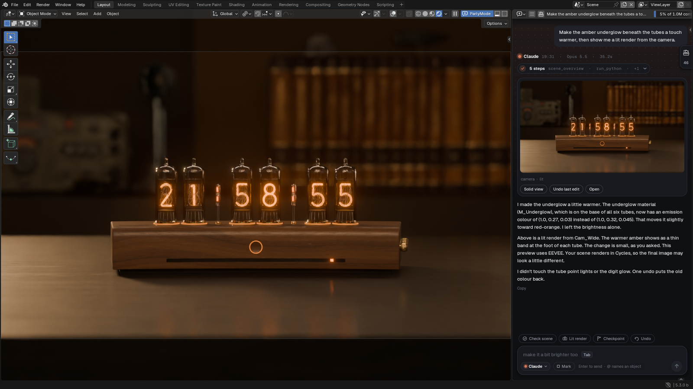
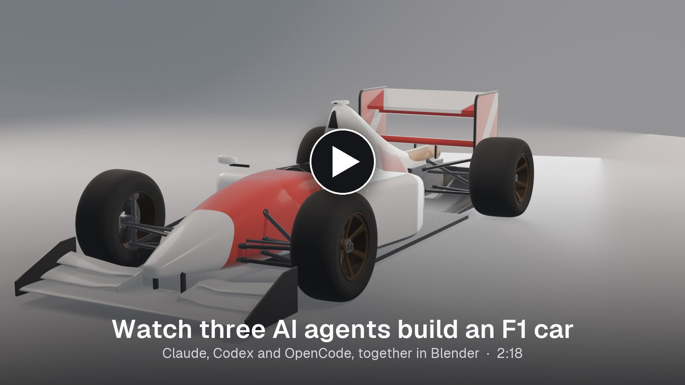
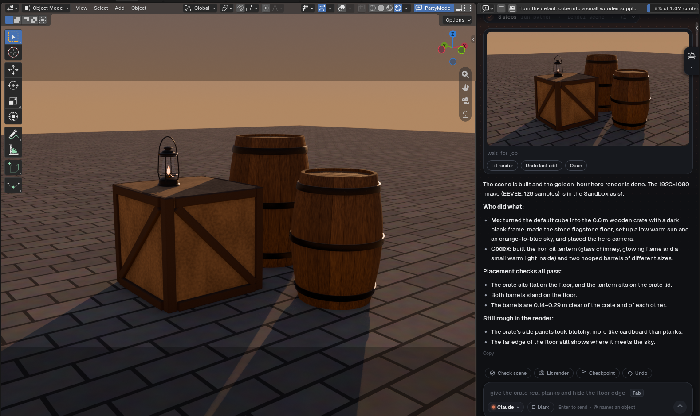
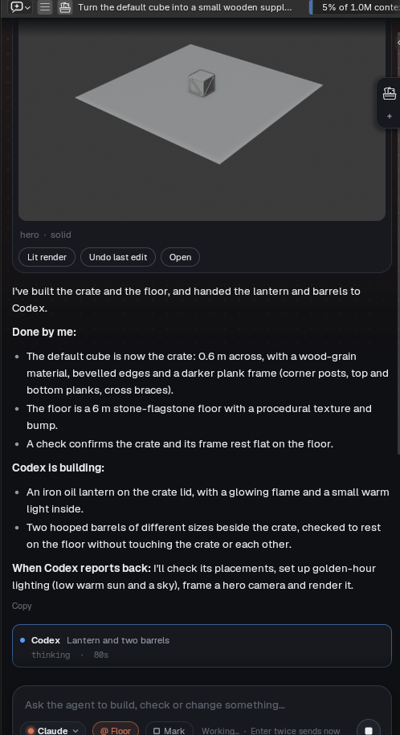
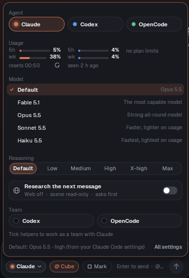
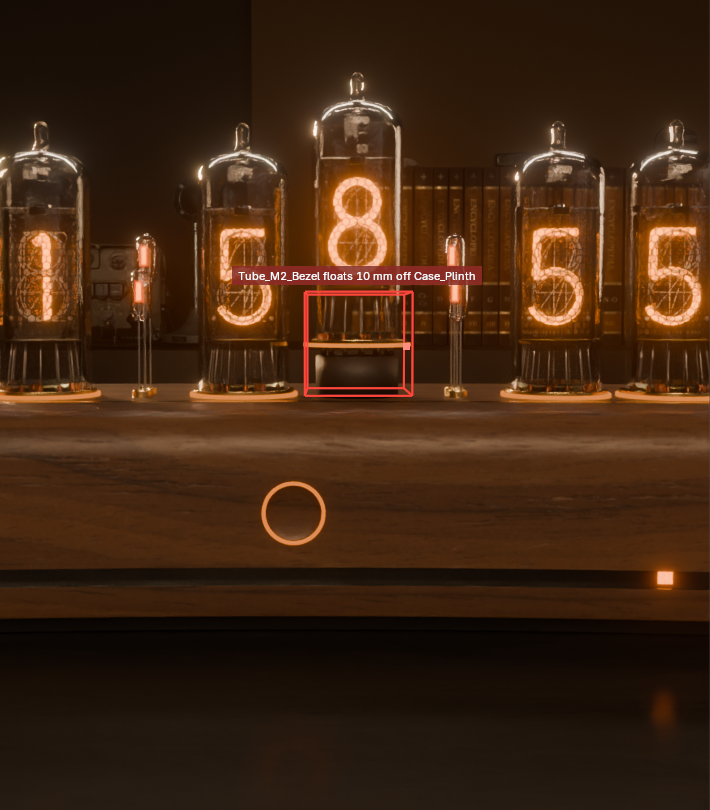
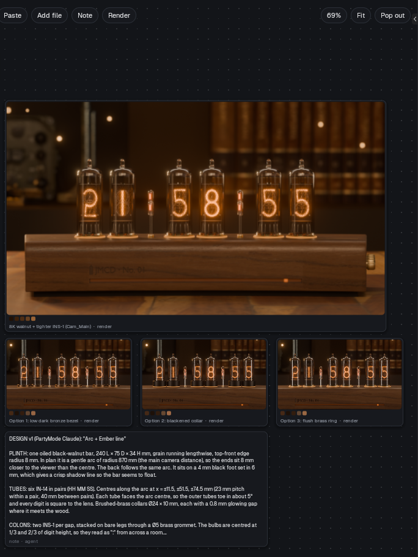
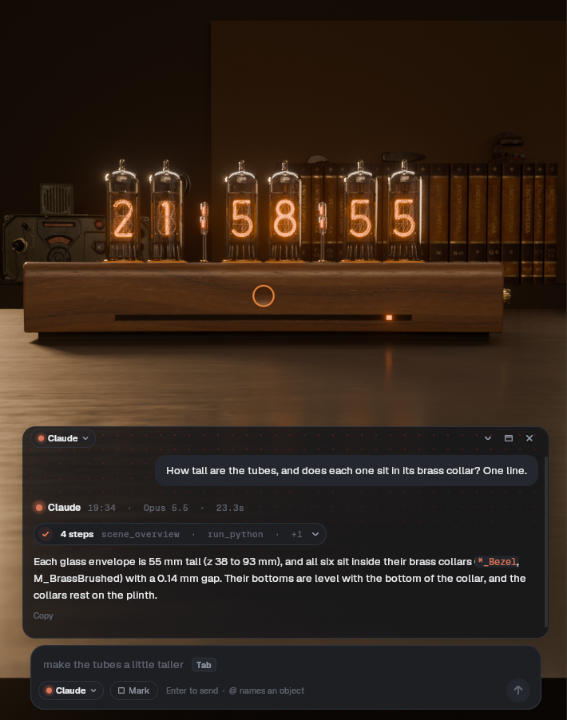
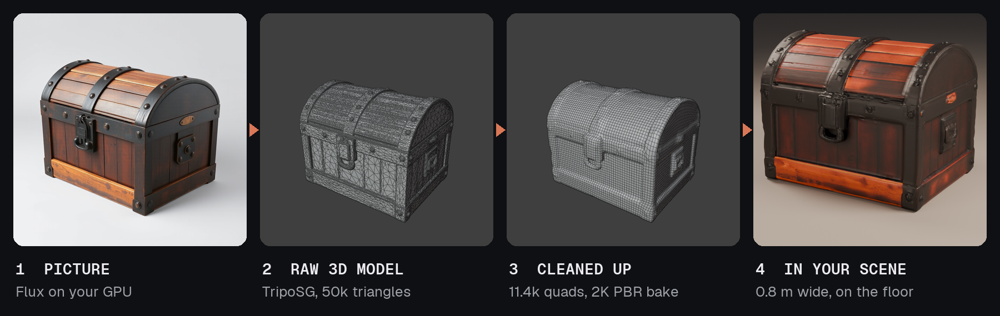

<h1 align="center">PartyMode</h1>

<b>Bring your AI agents into Blender, and let them build together.</b>

  <a href="https://github.com/Git-JMCD/partymode/releases/latest"><b>Download</b></a> ·
  <a href="GUIDE.md">Guide</a> ·
  Blender 5.2 or newer · Free and open source

Ask for what you want in plain words. Your agents build it in your scene, measure it, show you a
render, and every change is one Ctrl+Z away.

A real session, start to finish: five reference renders, one brief and seven rounds of notes.
Claude led, Codex built the wheels, suspension and wings, and OpenCode reviewed.
<a href="https://github.com/Git-JMCD/partymode/raw/main/media/partymode-f1-build.mp4">Watch the video (2:18)</a>

## Why bring them to the party

The usual setup keeps each AI in its own app, with Blender as one more tool it calls. Every agent
knows only its own conversation, so you end up as the go-between: copying tasks from window to
window, and finding out after the fact that two of them changed the same thing.

PartyMode turns that around. The agents come into Blender, and Blender itself keeps them working
as one team.

One message to Claude, with Codex ticked as a helper. About three minutes later: a crate,
a lantern and two barrels, every placement checked, lit and rendered.

**One goal, one plan.** Give the team a goal. The lead, say Claude, splits it into tasks and hands
them out. The helpers, say Codex and a local model, build at the same time. Then the lead checks
the result and sends back fixes.

**Same room, same picture.** Every agent sees the live scene, what the others just changed, and
what you did by hand. Nobody works from an old copy or a guess.

**No stepping on toes.** An agent claims what it's working on, even before it exists. Anyone else's
edit to it is stopped before it runs, with a note saying who has it and why.

**They talk to each other.** Agents leave notes for each other, and you can read every one in the
chat.

**One shared memory.** Every undo step is named for the agent that made it. The references,
renders and notes on the Sandbox board are there for all of them.

**You run it from one place.** Each agent's work lands in the same chat, under its own name, and a
helper's work sits in its own coloured panel. Talk to the lead while the helpers keep building, or
approve, redirect or stop the whole team, without leaving Blender.

**Direct from anywhere.** Not one for prompting? Talk to a terminal agent like Claude Code instead.
It joins the same room, pins your screenshots and scribbles to the Sandbox, and turns "the nose
looks pinched" into a precise note for whichever agent owns the nose.

**Use every plan you pay for.** Claude on your Claude plan, Codex on your ChatGPT plan, Grok,
Copilot or Gemini on theirs, and a free local model for the simple parts, all on one scene. The
agent menu shows how much of each plan's limits you've used, and the lead keeps a helper that's
nearly out to small tasks.

 

| | Agents in separate apps | Agents in PartyMode |
| --- | --- | --- |
| **Splitting the work** | You copy tasks between windows | The lead hands out tasks and reviews them |
| **Knowing what changed** | Each agent sees only its own edits | Everyone sees every edit, and yours |
| **Two agents, one object** | Found after the damage | Stopped before the edit runs |
| **Watching the work** | A window per agent | One chat, every agent by name |
| **Undoing a mistake** | Whose step was that? | Every step names its agent |

## And it does the work properly

**It checks, not guesses.** Does it sit on the floor or sink into it? Is it 4 m tall by mistake?
The agents measure in metres, and mark what's wrong right in your viewport.

**Nothing is a surprise.** Every edit is a named undo step. Try a change first, see before and after
side by side, and keep it only if you like it.

  
  

  
  

## Make things on your own GPU

Point PartyMode at your own [ComfyUI](https://github.com/comfyanonymous/ComfyUI) and the agents
can generate pictures and 3D models without anything leaving your machine. They don't stop at the
raw output, either: a generated model is remeshed into clean quads, baked, measured and set down in
your scene like anything else they build.

  

One message asked for a pirate treasure chest. Claude generated the picture with Flux on the GPU,
turned it into a model with TripoSG, then remeshed the 50k-triangle result into 11.4k quads with
clean UVs and 2K colour, roughness and normal maps. It kept the original hidden, saved a checkpoint
before the remesh, sized the chest to 0.8 m and checked it rests on the floor. Every step went into
the Sandbox, so you can see the picture, the before and the after side by side.

Works with the image, image-to-mesh and PBR mesh workflows you already have. Set the address and
workflow names in the add-on's preferences.

## Get started

1. **Download** the latest `PartyMode-<version>.zip` from [Releases](https://github.com/Git-JMCD/partymode/releases/latest). Don't unzip it.
2. **Install** it in Blender 5.2 or newer: drag the zip onto Blender, or Edit › Preferences › Get Extensions › ⌄ › Install from Disk.
3. **Click PartyMode** in the 3D View header and say what to make.

The chat needs one agent, signed in on your computer:
[Claude Code](https://claude.com/claude-code) (your Claude plan),
[Codex](https://github.com/openai/codex) (your ChatGPT plan), or
[OpenCode](https://opencode.ai) (hosted models, Meta's among them, or local ones that keep everything
on your machine). Or switch on Grok Build, GitHub Copilot, Gemini CLI or any other agent that speaks
the Agent Client Protocol, in the add-on's Agents settings.

Updates arrive in the add-on itself: one click in its preferences.

## Everything it does

**Chat**
- **Chat beside your viewport,** or as a bar floating in it.
- **Claude, Codex or OpenCode,** each with its own model and how hard it thinks. Grok, Copilot,
  Gemini or your own ACP agent when you switch them on.
- **Plan usage** in the agent menu: how much of Claude's and Codex's 5-hour and weekly limits is
  used, and when they reset.
- **@mention objects** to point at them, or **Mark** a box over any part of the screen.
- **Suggestions** for what's selected, and a guess at your next message (Tab takes it).
- **Three looks:** Halo, Signal and Classic. A new chat greets you with the agent's own logo, animated.
- **Chats are saved;** pick one up later, even with a different agent.

**Safety**
- **Every edit is one undo step,** with a report of exactly what changed.
- **Try before you keep:** before and after renders, the difference measured.
- **Save points** that survive restarts, and Stop at any time.

**Checks**
- **Rests on, touches, collides,** measured in millimetres.
- **Mesh health and real-world size,** and UV layouts.
- **Failed checks are marked** right in the viewport.

**Make and fix**
- **Lighting presets:** studio, golden hour, noon, overcast, night, from the side you say.
- **Material looks:** wet, dirt in creases, worn edges, tint to a palette.
- **Free assets** from Poly Haven, at real size, plus your own libraries.
- **Repair a mesh** in one step, or **remesh** a generated one into clean quads.
- **Tidy a file:** unused data, duplicates, unapplied scale, default names.
- **Generate** images and 3D models with your own ComfyUI, then clean them up into game-ready
  quads with baked textures.

**Review and deliver**
- **Turntables and contact sheets** in one call.
- **Animation checks:** foot sliding, loop seams, in-place speed.
- **Export** for Unreal, Unity, Godot or the web, checked by importing it back, with levels of
  detail and collision.

**Sandbox**
- **A board for references, logos, notes and renders,** shared with the agent.
- **Paste from Figma** or anywhere; an SVG becomes a 3D logo, a picture a palette.
- **Full renders in the background** while you keep working.
- **Research:** the agent pulls openly licensed pictures in, asking you first.

**Teams**
- **One agent leads, the others help** on the same scene, at the same time. Tick helpers in the
  agent menu.
- **The lead plans, hands out tasks and reviews them,** and hears straight away if a helper gets
  stuck.
- **Talk to the lead while helpers work:** your message goes straight to it, or waits for its reply,
  and the helpers keep going. A helper that's gone quiet shows how long for.
- **Each helper's work sits in its own coloured panel,** so a helper's report never reads as the
  lead's.
- **A helper keeps its own conversation** from task to task, so a fix doesn't start from scratch.
- **Claims** keep agents off each other's objects, even ones not built yet.
- **Notes** between agents, and every edit says who made it.
- **Works from a terminal too:** Claude Code, Codex and other MCP clients join the same room.

The [Guide](GUIDE.md) has the details on each.

## Good to know

- It runs on your computer. The server only answers your own machine, and agents in the chat can't
  run commands or touch files outside Blender.
- What you type goes to the AI you pick. A local model keeps it all at home.
- Early and moving fast. Tested on Windows; [reports](../../issues) from macOS and Linux are welcome.

[Report a bug](../../issues) · [License](#license)

## License

GPL-3.0-or-later, like Blender's own add-ons. The bundled fonts are under the SIL Open Font License
1.1. Details in the [Guide](GUIDE.md#license).
